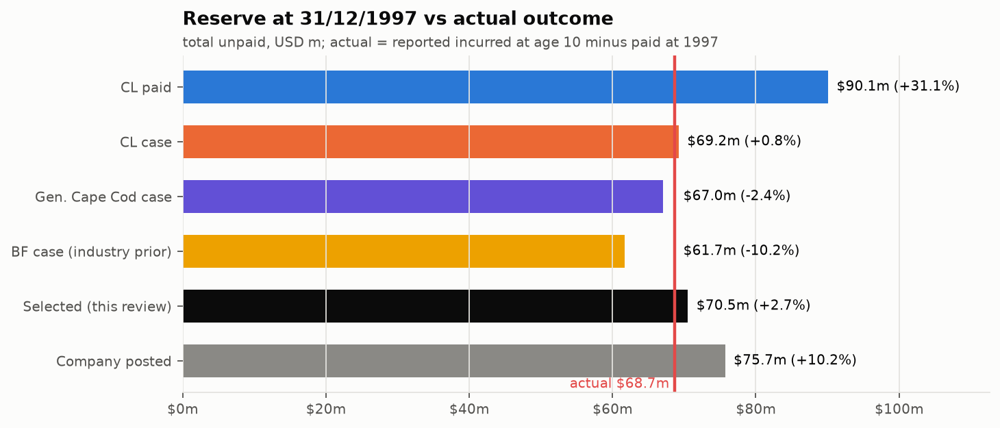
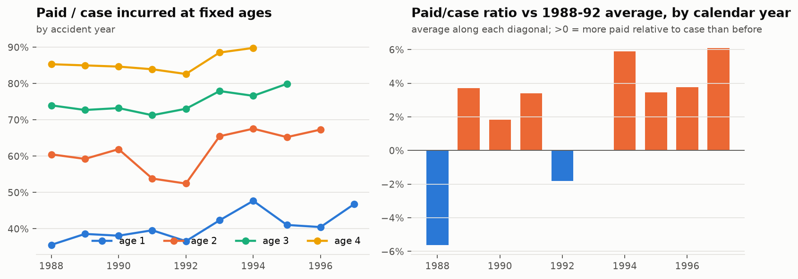
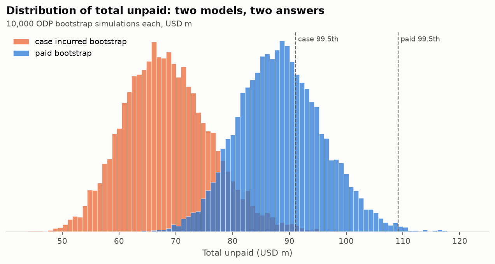
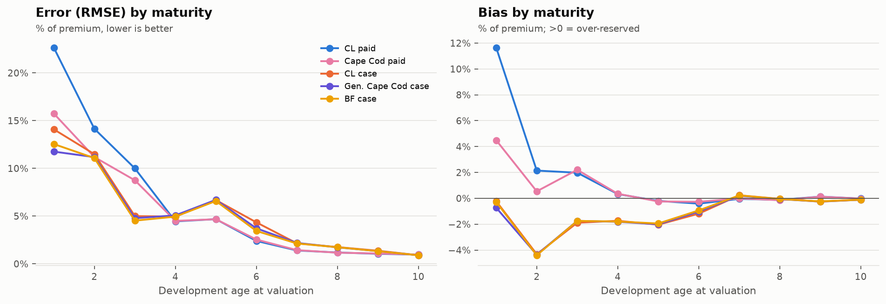
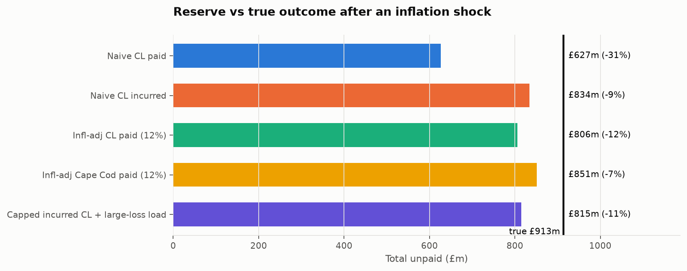

# Commercial Auto Reserving Review

An end-to-end **claims reserving review** in Python, built on **real insurer data** (NAIC Schedule P via the CAS Loss Reserving Database) and **claim-level transaction data** (SPLICE). It goes from data selection, diagnostics and factor selection, through deterministic and stochastic methods, to a **defended, year-by-year selected reserve**, and then uses hindsight to test how good that selection was.

[](https://github.com/yusufali-act/commercial-auto-reserving-review/actions/workflows/ci.yml)

> **Headline:** for Penn National's commercial auto book at 31/12/1997, the selected reserve was **$70.5m**, within **2.7%** of the actual outcome ($68.7m). The paid chain ladder would have over-reserved by **31%**, and the company's booked reserve held a **10%** margin.



---

## Why this project

This is my second reserving project. The first ran chain ladder and BF on a textbook triangle bundled with a Python package. Looking back, its weaknesses were the interesting part:

| First project | This project |
|---|---|
| Sample triangle with no premium, no incurred, no outcome | **Real Schedule P data** for 158 insurers: paid, case incurred, IBNR, premium, **and the full square** (actual outcomes) |
| BF prior = CL ultimate × an assumed growth rate (circular) | Prior from **premium × expected loss ratio**, comparing industry, Cape Cod and generalised Cape Cod, chosen on evidence |
| One volume-weighted factor set | Volume / simple / medial × all / 5 / 3 years, **outlier flagging, justified (non-)exclusions**, impact of each choice |
| No tail, inflation or large-loss treatment | **Curve-fitted tails** with industry cross-check; **inflation-adjusted CL** and **large-loss capping** on claim-level data |
| Deterministic only | **Mack** and **ODP bootstrap**, both hand-written and validated against published results |
| "CL says X, BF says Y" | **Evidence-weighted selection by maturity**, back-tested on 30 companies out of sample, with a stated rationale for every year |
| Ready-made triangle | **Triangles built from 53,724 claim transactions**, reconciled to the penny |

## Data

1. **[CAS Loss Reserving Database](https://www.casact.org/publications-research/research/research-resources/loss-reserving-data-pulled-naic-schedule-p)** (Meyers & Shi). Schedule P Part 1, commercial auto liability, accident years 1988-1997 with 10 years of development each. Reserving is done as at 31/12/1997 on the upper triangle; the lower triangle is **hindsight**, used only for back-testing.
2. **[SPLICE](https://cran.r-project.org/package=SPLICE)** (Avanzi, Taylor & Wang). A peer-reviewed simulator of individual claims with payments and case-estimate revisions. Used because real claim-level reserving data is never public. The scenario includes a **mid-2022 inflation shock** like the one UK/US motor books experienced. See [`data/README.md`](data/README.md).

## The review, notebook by notebook

| # | Notebook | Question | Key finding |
|---|---|---|---|
| 01 | [Data & company selection](notebooks/01_data_and_company_selection.ipynb) | What are we reserving? | Company chosen by documented screens using **only pre-1998 data** (tested: tampering with the lower triangle doesn't change the screen) |
| 02 | [Triangles & diagnostics](notebooks/02_triangles_and_diagnostics.ipynb) | Is the past a good guide? | **Paid/case ratios jumped from 1993.** Either faster settlement or weaker case reserves, with opposite effects on the reserve |
| 03 | [Factors & tail](notebooks/03_development_factors_and_tail.ipynb) | Which factors, how much tail? | The averaging rule moves the reserve by up to ~$11m (short windows); **the paid vs case basis by $15-23m on every rule**. Tail 1.005 / 1.002 |
| 04 | [Methods](notebooks/04_reserving_methods.ipynb) | What does each method say? | Range **$61m-$90m**. An industry prior understates because the company drifted above the market |
| 05 | [Uncertainty](notebooks/05_uncertainty.ipynb) | How uncertain? | Mack/bootstrap CV ≈ 9-11%, yet **the paid and case bootstraps barely overlap**: model risk dominates |
| 06 | [Back-testing](notebooks/06_backtesting.ipynb) | Which methods work, when? | Across 30 companies: case/Cape Cod best when immature, paid when mature; **a blend beats every single method out of sample** |
| 07 | [Claim-level: inflation & large losses](notebooks/07_claim_level_large_loss_inflation.ipynb) | What changes with claim data? | Naive paid CL **−31%** after an inflation shock; inflation-adjusted Cape Cod **−7%** |
| 08 | [Selected reserve](notebooks/08_selected_reserve.ipynb) | What do I recommend, and was it right? | **$70.5m** (IQR $66-74m); actual $68.7m |

### Selected charts

| | |
|---|---|
|  |  |
| **Diagnostics:** paid/case ratios shifted up from 1993 | **Model risk:** two confident models that disagree |
|  |  |
| **Back-test:** paid CL is the worst estimator at age 1, biased +12% | **Inflation shock:** what breaks and what fixes it |

## How the final reserve was selected

1. **Evidence weights.** Inverse-MSE weights by maturity band (ages 1-2 / 3-5 / 6-10) across four methods (CL and Cape Cod, on paid and case), learned from **30 other companies' actual outcomes** and checked out of sample.
2. **One company-specific overlay.** Paid weight halved for ages 1-5, because the company's paid/case shift (notebook 02) could make every paid method overstate, and industry evidence can't see that.
3. **Reasonableness checks.** Implied loss ratios, implied development vs pattern, IBNR vs case reserves, comparison with the booked reserve.
4. **Range.** Lognormal with the case-basis Mack CV, plus explicit discussion of model risk, which the stochastic models don't capture.

Full write-up: **[reports/reserving_report.md](reports/reserving_report.md)**.

## Repository structure

```text
├── src/reserving/          # tested Python package: all the actuarial maths lives here
│   ├── triangle.py         # triangle class: link ratios, diagonals, cut back to earlier valuations
│   ├── factors.py          # averaging bases, outlier flags, tail curve fitting, CDFs
│   ├── methods.py          # chain ladder, ELR, BF, Cape Cod (incl. generalised), Benktander
│   ├── diagnostics.py      # paid/case ratios, calendar shifts, ODP residuals, count diagnostics
│   ├── uncertainty.py      # Mack (1993), ODP bootstrap (England & Verrall 2002)
│   ├── backtest.py         # rolling and cross-company back-tests
│   ├── selection.py        # maturity bands, evidence weights, out-of-sample evaluation
│   ├── large_loss.py       # inflation index, real-terms projection, capping, large-loss load
│   ├── data.py             # CAS loader + screening; SPLICE transactions -> triangles
│   ├── config.py           # every selected assumption, in one place, with its justification
│   └── pipeline.py         # reproduces every headline number from raw data
├── notebooks/              # the narrative: 8 executed notebooks (01-08)
├── reports/                # actuarial-style reserving report
├── tests/                  # 25 tests incl. validation vs Mack (1993) and the chainladder package
├── data/                   # download script, SPLICE generator (R), processed claim data
└── outputs/                # figures, tables, results.json
```

## Validation

The methods are hand-written rather than called from a library, so they're tested against independent references:

* **Chain ladder reserve** on the Taylor & Ashe (1983) triangle = **18,680,856**, as published in Mack (1993)
* **Mack total standard error = 2,447,095** and per-origin errors match Mack (1993) exactly
* Volume and simple factors, BF and Cape Cod match the [`chainladder`](https://github.com/casact/chainladder-python) package to 1e-8
* The bootstrap mean is within 3% of the CL reserve; inflation-adjusted CL collapses to the plain CL at 0% inflation
* **No-hindsight checks:** company screening and back-test estimates are unchanged when the lower triangle is altered

## Running it

```bash
make setup      # venv + dependencies
make test       # 25 tests
make results    # downloads CAS data, writes outputs/results.json and tables
make notebooks  # re-executes all notebooks and regenerates every figure
```

The SPLICE data is committed, so R isn't needed. To regenerate it: `make splice` (requires R with `SPLICE` and `arrow`).

## Limitations

* Schedule P Part 1 has **no claim counts**, so the paid/case question couldn't be settled directly. Berquist-Sherman adjustments are demonstrated on the claim-level data instead.
* Data is **net of reinsurance and undiscounted** (US statutory). There's no gross/net analysis, discounting or explicit risk margin (IFRS 17 / Solvency II).
* Uncertainty is on an **ultimate** view. A Solvency II one-year view (Merz-Wüthrich) would be a natural extension.
* The cross-company back-test uses other companies' later outcomes as a stand-in for the track record (own actual-vs-expected history, industry studies) an actuary would have had in 1997.
* SPLICE is synthetic. It's realistic in structure, but its conclusions illustrate methods; they aren't market facts.

## About

Built by an actuarial analyst with a background in **bulk purchase annuity pricing and pensions**, as preparation for general insurance reserving. Several ideas carry straight across: best estimate vs prudence margins, stress and percentile thinking (longevity stress ↔ reserve risk at 99.5%), and the discipline of separating assumptions from methodology (`config.py`).

## References

* Mack, T. (1993). *Distribution-free calculation of the standard error of chain ladder reserve estimates.* ASTIN Bulletin 23(2).
* England, P. & Verrall, R. (2002). *Stochastic claims reserving in general insurance.* British Actuarial Journal 8(3).
* Bornhuetter, R. & Ferguson, R. (1972). *The actuary and IBNR.* PCAS.
* Berquist, J. & Sherman, R. (1977). *Loss reserve adequacy testing: a comprehensive, systematic approach.* PCAS.
* Gluck, S. (1997). *Balancing development and trend in loss reserve analysis* (generalised Cape Cod). PCAS.
* Sherman, R. (1984). *Extrapolating, smoothing and interpolating development factors.* PCAS.
* Meyers, G. & Shi, P. (2011). *Loss reserving data pulled from NAIC Schedule P.* CAS.
* Avanzi, B., Taylor, G., Wang, M. & Wong, B. (2021). *SynthETIC: an individual insurance claim simulator with feature control.* Insurance: Mathematics and Economics.
* Avanzi, B., Taylor, G. & Wang, M. (2023). *SPLICE: a synthetic paid loss and incurred cost experience simulator.* Annals of Actuarial Science.
* Friedland, J. (2010). *Estimating Unpaid Claims Using Basic Techniques.* CAS.
